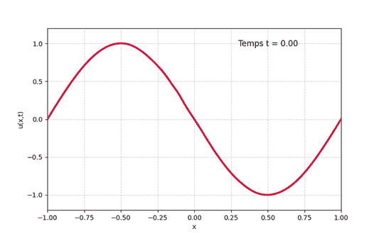
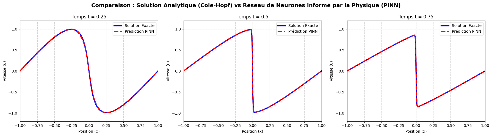

# Résolution de l'équation de Burgers avec un PINN

Un réseau de neurones entraîné à résoudre une équation aux dérivées partielles, sans aucune donnée : seule l'équation sert à l'entraînement.

<p align="center"></p>

## Objectif

Résoudre l'équation de Burgers visqueuse sur $x \in [-1, 1]$, $t \in [0, 1]$ :

```math
\frac{\partial u}{\partial t} + u\,\frac{\partial u}{\partial x} = \nu\,\frac{\partial^2 u}{\partial x^2},
\qquad u(x, 0) = -\sin(\pi x), \qquad u(\pm 1, t) = 0, \qquad \nu = \frac{0.01}{\pi}
```

Avec une viscosité aussi faible, la solution forme un choc en $x = 0$ : la vitesse passe presque instantanément de +1 à -1. C'est ce qui rend le problème difficile.

## Démarche

- Réseau entièrement connecté en PyTorch : 2 entrées $(x, t)$, 4 couches de 50 neurones (tanh), 1 sortie $u$.
- Fonction de perte construite à partir de la physique : résidu de l'équation en 10 000 points du domaine, condition initiale (200 points) et conditions aux bords (400 points).
- Dérivées $u_t$, $u_x$, $u_{xx}$ calculées par différentiation automatique.
- Entraînement avec l'optimiseur L-BFGS (le notebook explique ce choix par rapport à Adam).
- Validation en comparant à la solution exacte, obtenue par la transformation de Cole-Hopf.

## Résultats

- Loss finale : 4,0 × 10⁻⁵
- Erreur relative par rapport à la solution exacte : **0,45 %**, choc compris

<p align="center"></p>

## Outils

Python, PyTorch, NumPy, Matplotlib

## Utilisation

Le notebook [`pinn_burgers.ipynb`](pinn_burgers.ipynb) contient le code et les explications. Il s'ouvre directement dans Google Colab, ou en local :

```bash
pip install -r requirements.txt
jupyter notebook pinn_burgers.ipynb
```
